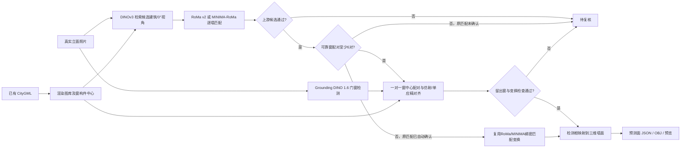
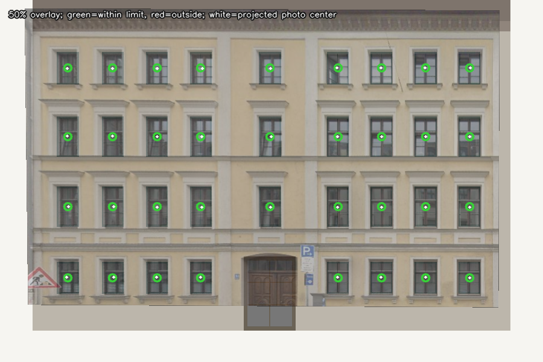

# 当前成果与运行入口（2026-10-19）

本页是项目的**当前索引**。此前的多视角实验、固定建筑实验和人工标定仍保留在 [实验记录](experiment_log.md)；下表只比较同一批 **17 张立面照片、同一 0° 渲染图库**上的实验 1/1.1/2/2.1。

## 已经实现到哪里

1. 数据集已有 CityGML 建筑及其 Window/Door 几何。项目已为 **27 栋建筑**建立多视角渲染图库；0° 对照使用其中 **145 张正视墙面图**。
2. 实验 D 使用 Grounding DINO 1.6 Pro 检测了 **17/17 张照片**，保存原图像素坐标、类别、分数和可视化。批次汇总为 **397 个窗、27 个门、2 个待确认**，这些是预测数量，不是准确率。
3. DINOv3 将照片与渲染图做特征检索，筛出候选建筑和视角；RoMa v2 或 MINIMA-RoMa 再提供照片到候选墙面的密集对应和初始变换。
4. 在**候选筛选之后**有两条路径：至少 6 对窗时，照片窗中心与 CityGML 渲染窗中心一对一配对，6–7 对拟合**仿射变换**、8 对以上拟合**单应矩阵**，并用留出窗验收；少于 6 对时，只有原 RoMa/MINIMA 稠密匹配已经自动选定同一建筑墙面，才复用原变换，不用 4 对窗强拟合。稠密 RoMa 留出点内点比例门槛从 0.50 小幅调至 0.45，其余上游检查仍须通过。
5. 通过的检测框可投到所选三维墙面，输出 JSON、OBJ 和预览图。它们是**独立预测面**；原 CityGML 没有开孔，也没有写出新的 LoD3 模型。



## 最新完整对照

| 指标，均为 17 张 | 实验 1：RoMa v2 | 实验 1.1：RoMa + 窗中心 | 实验 2：MINIMA-RoMa | 实验 2.1：MINIMA-RoMa + 窗中心 |
|---|---:|---:|---:|---:|
| 正确建筑进入候选 | 14 | 14 | 14 | 14 |
| 正确建筑自动映射 | 5 | 5 | 7 | 9 |
| 错配建筑自动映射 | 0 | 0 | 1 | 1 |
| 待复核 | 12 | 12 | 9 | 7 |

**几何门槛试验（2026-10-12）：**表中实验 1.1/2.1 使用温和放宽窗布局覆盖范围后的完整 17 张批次。较早一轮实验 2.1 为 8 张正确建筑映射、1 张错配、8 张待复核；此轮唯一新增的正确建筑映射是 `4959323_right.png`，生成 13 个三维预测面。实验 1.1 的 5/0/12 不变。新结果仍缺独立墙面/三维真值；参数与完整本机路径见[窗中心实验教程](experiment_window_centers.md)。

实验 1.1 的总体接受数量与实验 1 相同。与原 8 对窗/0.50 门槛的实验 2.1 批次相比，`4906970.png` 因允许 6 对窗的仿射拟合恢复正确映射，`4959322.jpg` 因 0.45 稠密内点比例门槛新增正确映射。两张的中心叠加图已目视检查；`4906981.jpg` **仍被错配**到另一栋建筑。这里的“正确”只按文件名中的建筑 ID 核对，不能证明墙面和米制坐标准确，也不是独立测试集结果。

表中原实验 1/2 与新批 1.1/2.1 同时有对齐方法和验收门槛差异，因此不能把指标变化单独归因于窗中心方法。
少窗稠密回退已实现并用临时 4 窗回放验证，但这组真实 17 张中 **0 张触发回退**，所以上表数字没有因新增分支而变化。



图中绿色圆圈与白点的连线表示残差，红色表示超出阈值。旧批次曾把另一候选的渲染窗编号用于绘图，产生跨立面的长绿线；上图来自**修正可视化后**的完整批次。叠加良好只能说明该候选的窗中心几何自洽，不能单凭它证明建筑身份或三维位置真实正确。

仓库内保存了最新[汇总](results/window_centers_20261012_relaxed/comparison.md)、[实验 1.1 逐照片表](results/window_centers_20261012_relaxed/experiment_1.1_per_photo.csv)、[实验 2.1 逐照片表](results/window_centers_20261012_relaxed/experiment_2.1_per_photo.csv)和[机器可读摘要](results/window_centers_20261012_relaxed/summary.json)。早期门槛试验仍在本机 `my_results/` 中保留。本机最新完整诊断（每个候选的配对、误差、叠加图和三维预览）位于 `E:\workinCODEX\prog_3D\my_results\experiment_window_centers\window_centers_20261012_145618_436419`；仓库只保存轻量结果快照。

## 要打开哪个代码

| 目的 | 入口或模块 | 是否会用云端额度 |
|---|---|---|
| 看最新 0° 四组对照，复跑窗中心阶段 | [`run_experiment_window_centers.py`](../run_experiment_window_centers.py) | 不会；读取已保存的检测和匹配结果 |
| 从头比较 RoMa 与 MINIMA-RoMa | [`run_experiment_front0.py`](../run_experiment_front0.py) | 不会；要求现有检测缓存和本地模型权重 |
| 给新照片做门窗检测 | [`try_grounding_dino16.py`](../try_grounding_dino16.py) | 会调用 Grounding DINO 1.6 云 API |
| 对一张照片运行原自动找楼流程 | [`run_facade_pipeline.py`](../run_facade_pipeline.py) | 有合格检测缓存则复用；新检测可能收费 |
| 建立多建筑或墙面图库 | [`build_render_gallery.py`](../build_render_gallery.py)、[`build_wall_view_gallery.py`](../build_wall_view_gallery.py) | 不会 |
| 查看中心拟合与核对图实现 | [`vlm_window_alignment.py`](../vlm_window_alignment.py) | 本地函数不收费；仅显式选择 `MODE="api"` 才会调用 OpenAI API |

这几个入口**不需要同时运行**。PyCharm 中选择 `torch_1`，若只是复核最新批次，直接打开上面的 CSV 和 PNG；若需要重新生成一个实验批次，运行 `run_experiment_window_centers.py`。详细操作见 [窗中心实验教程](experiment_window_centers.md) 和 [PyCharm 教程](pycharm_tutorial.md)。

代码的调用关系可以这样读：

```text
try_grounding_dino16.py -> facade_geometry.py -> 已保存的 detections.json
build_wall_view_gallery.py -> render_building_views.py -> 0° 渲染图/相机/构件图
run_experiment_front0.py -> run_facade_pipeline.py
    -> facade_retrieval.py                 （DINOv3 检索）
    -> match_facade_roma.py 或 match_facade_minima_roma.py
    -> facade_match_geometry.py / facade_match_structure.py
    -> facade_auto_mapping.py              （三维预测面）
run_experiment_window_centers.py -> 读取上述实验 1/2 保存的候选结果
    -> vlm_window_alignment.py 中的窗编号、仿射/单应拟合与核对图函数
    -> 少于 6 对时仅复用已自动确认的上游稠密变换
    -> facade_auto_mapping.py              （通过时生成新预览）
```

`map_facade_to_3d.py` 是历史人工标定工具，`run_experiment_e45.py` 是另一条多视角实验入口；它们不需要与 0° 窗中心批量实验一起运行。`docs/results/` 保留可分享的轻量快照，完整 `my_results/`、模型权重与缓存留在本机。这样看代码时，先看**入口**，再沿调用关系查看模块，不必从文件夹第一个文件逐个运行。

## 结论边界与下一步

- 建筑 ID 的“正确/错配”来自照片文件名，在推理结束后统计；目前没有独立的逐照片**墙面、窗对应和三维坐标真值**。17 张开发照片曾用于调试，不能当作独立测试集准确率。
- 当前窗配对来自**本地一对一距离分配**，并非 GPT 视觉模型。`vlm_window_alignment.py` 中的视觉模型 API 模式只是单候选试验入口；本轮没有 API 密钥，也没有运行它。
- 目前最有价值的后续工作是为照片标注“正确建筑 + 正确墙面 + 若干对应窗”，再分别测候选召回、墙面选择、窗对应与三维投影误差；对规则窗列造成的错配应单独分析。只有通过独立核对后，才适合扩大自动写入范围。
